# SILÊNCIO NA BIBLIOTECA

### Manual do jogador

**Versão 1.0 · novembro de 2026**

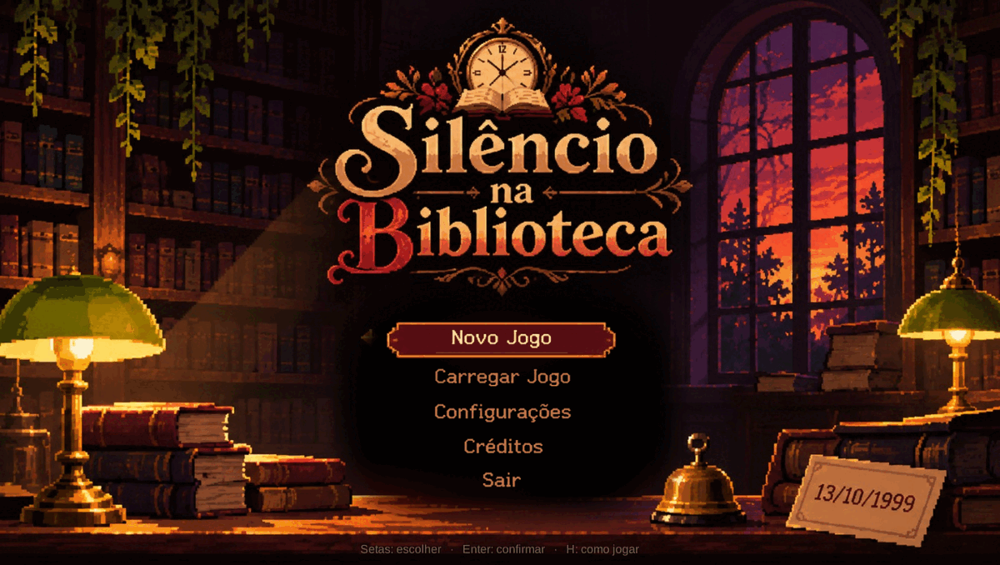

*Arthur Carvalho Rotkis · Cauê Iwamoto Meira · Hanna de Oliveira Melo · Sérgio de Siqueira Santos*

FEI — Jogos Digitais · 7º ciclo

---

## Como usar este manual

Este manual explica o jogo do começo ao fim para quem nunca jogou. Leia os capítulos 1 a 8 antes da primeira partida. Os capítulos 9 a 11 servem de consulta durante o jogo. O capítulo 12 traz partidas comentadas e o capítulo 13 responde às dúvidas mais comuns.

Os **apêndices trazem spoilers** (solução completa, lista de pistas e o culpado). Consulte-os apenas se estiver travado ou se já tiver terminado o jogo.

> **Convenção:** tudo o que você precisa fazer aparece em **negrito**. Nomes de teclas aparecem em `código`. Blocos com borda como este destacam regras importantes.

---

## Sumário

1. [Apresentação do jogo](#1-apresentação-do-jogo)
2. [História e ambientação](#2-história-e-ambientação)
3. [Objetivos](#3-objetivos)
4. [Componentes e funcionalidades](#4-componentes-e-funcionalidades)
5. [Interface e mapa](#5-interface-e-mapa)
6. [Preparação da partida](#6-preparação-da-partida)
7. [Regras gerais](#7-regras-gerais)
8. [Mecânicas e controles](#8-mecânicas-e-controles)
9. [Ações e movimentações](#9-ações-e-movimentações)
10. [Modos de jogo](#10-modos-de-jogo)
11. [Condições de vitória, derrota e conclusão](#11-condições-de-vitória-derrota-e-conclusão)
12. [Exemplos de partidas](#12-exemplos-de-partidas)
13. [Dúvidas frequentes](#13-dúvidas-frequentes)
- [Apêndice A — Solução completa (com spoilers)](#apêndice-a--solução-completa-com-spoilers)
- [Apêndice B — Pistas, provas e onde encontrá-las](#apêndice-b--pistas-provas-e-onde-encontrá-las)
- [Apêndice C — Checklist de validação do manual](#apêndice-c--checklist-de-validação-do-manual)
- [Apêndice D — Glossário e ficha técnica](#apêndice-d--glossário-e-ficha-técnica)

---

## 1. Apresentação do jogo

### 1.1 O que é

**Silêncio na Biblioteca** é uma aventura narrativa de investigação em pixel art. Você é a nova assistente de uma biblioteca pública no dia 13 de outubro de 1999. Às 15h, um incêndio destrói o arquivo do prédio — e você desmaia. Quando abre os olhos, o relógio marca 12h de novo, no mesmo dia, com as mesmas pessoas.

Só você se lembra do que aconteceu. Seu objetivo é usar essas voltas para descobrir quem provocou o incêndio e provar a culpa antes que o fogo comece.

### 1.2 Proposta

O jogo não pede reflexo nem combate. Ele pede **observação, conversa e memória**:

- **Observar** o que cada pessoa diz e faz em cada horário.
- **Conversar** com respeito, conquistando confiança aos poucos.
- **Anotar** fatos no caderno e cruzá-los entre as voltas.
- **Acusar** somente quando tiver provas — e mostrar essas provas à pessoa certa.

### 1.3 Público e duração

| Item | Descrição |
|---|---|
| Jogadores | 1 pessoa |
| Gênero | Aventura narrativa / investigação com repetição temporal |
| Duração de uma partida | 15 a 30 minutos (depende de quantas voltas você precisar) |
| Faixa etária | Livre — há menção a incêndio e a um crime do passado, sem violência gráfica |
| Idioma | Português do Brasil |
| Plataformas | Windows 10/11 (64 bits) e Linux (64 bits) |

### 1.4 Como é uma partida, em resumo

1. Você começa às **12h00** e tem até as **15h00** para agir.
2. Conversa com as pessoas e executa pequenas tarefas da biblioteca.
3. Ao aprender fatos novos, eles entram no **caderno de pistas**.
4. Às 15h00 o incêndio acontece e você volta às 12h00 — **mantendo o que aprendeu**.
5. Quando reunir provas suficientes, **cumprimente o suspeito e escolha ACUSAR**.
6. Mostre **três provas fortes** que apontem para a pessoa certa para vencer.

> O jogo **não tem salvamento**. Fechar o programa reinicia a partida do zero. Uma partida inteira cabe em uma sessão de 15 a 30 minutos.

---

## 2. História e ambientação

### 2.1 O dia 13 de outubro de 1999

A biblioteca abre às 12h. O dia está comum: luz de outubro nas janelas, poeira nas estantes, o cheiro de papel velho. Às 15h, o alarme de incêndio dispara, uma fumaça densa sai do arquivo — a sala da parede esquerda — e você desmaia.

Ao acordar, está de pé diante do balcão. O relógio marca 12h00. Dona Marta repete, palavra por palavra, o bom-dia que já deu. Ninguém lembra de nada. Você é a única pessoa presa nesse dia.

### 2.2 O mistério

O arquivo guarda um relatório de vistoria predial de **1989**. O documento aponta problemas graves na fiação elétrica do prédio. Alguém retirou esse relatório do arquivo no dia de hoje — e o incêndio começa exatamente ali. Descobrir quem retirou a pasta, como entrou e por quê é o centro da investigação.

### 2.3 Personagens

| Personagem | Quem é | Onde costuma estar |
|---|---|---|
| **Você** | Assistente de biblioteca, contratada há pouco. Única pessoa que lembra das voltas. | Livre pelo salão |
| **Dona Marta** | Bibliotecária responsável, no balcão. Organizada, desconfiada com quem fala demais. | Balcão, quase o tempo todo |
| **Seu Jorge** | Zelador há quarenta anos. Simpático, dono do molho de chaves da Zeladoria. | Circulando com o esfregão |
| **Lucas** | Estudante de Química Orgânica, nervoso com a prova. | Mesas de leitura; sai para almoçar |
| **Helena** | Jornalista freelancer investigando a história do prédio. | Mesas e estantes |
| **Rodrigo** | Professor que pediu a pasta de 1989 e diz que sai às 13h05. | Arquivo, no começo da tarde |

### 2.4 Tom

O jogo é um drama de mistério leve. Não há sustos, tiros ou mortes em cena. A tensão vem do relógio, das conversas e da sensação de repetir o mesmo dia.

---

## 3. Objetivos

### 3.1 Objetivo geral

**Descobrir quem provocará o incêndio no arquivo às 15h e provar a culpa com três provas fortes.**

### 3.2 Objetivo da primeira volta

A primeira volta serve para você entender o lugar e o funcionamento do dia. O jogo indica a tarefa no alto da tela:

1. **Apresente-se à Dona Marta**, no balcão.
2. **Devolva os livros do carrinho** (à direita do salão).
3. **Arrume a estante inferior esquerda**.
4. **Destrave o terminal do balcão**.
5. **Converse com as pessoas** até o fim do turno.

Nenhuma dessas tarefas é obrigatória para vencer, mas todas rendem informações, confiança e pistas.

### 3.3 Objetivos das voltas seguintes

Depois do primeiro incêndio, o objetivo muda para:

> **Objetivo: descubra quem vai provocar o incêndio. Para acusar alguém, cumprimente a PRÓPRIA pessoa e depois escolha ACUSAR.**

A partir daí, cada volta tem três metas pessoais:

- **Confirmar** o que já sabe e preencher as lacunas do caderno.
- **Conquistar confiança** para que as pessoas revelem o que viram.
- **Reunir provas** que liguem uma pessoa ao arquivo no horário do incêndio.

### 3.4 O que conta como vitória

A vitória acontece em uma única situação: você confronta a pessoa culpada e ela **confessa**. Para isso, é preciso mostrar **três provas fortes** que a apontem como responsável (veja o capítulo 8.6).

---

## 4. Componentes e funcionalidades

Esta seção funciona como uma enciclopédia: consulte sempre que esquecer para que serve um elemento da tela.

### 4.1 A tela de jogo (HUD)

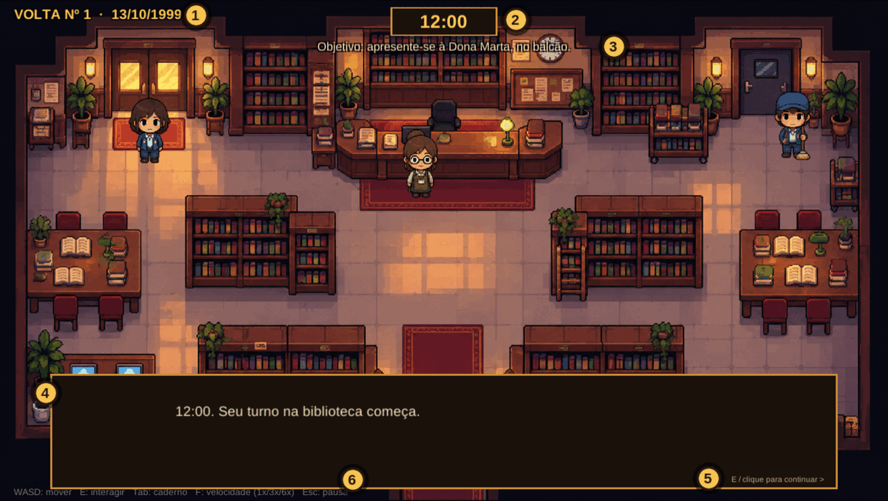

| Nº | Elemento | Função | Observações |
|---|---|---|---|
| 1 | **Volta e data** | Mostra em que repetição do dia você está e a data (13/10/1999). | A volta nº 1 é a primeira. Não há limite de voltas. |
| 2 | **Relógio** | Mostra a hora do jogo, de 12:00 a 15:00. | Fica **avermelhado nos últimos 30 minutos** de jogo antes do incêndio. |
| 3 | **Objetivo** | Uma linha com a próxima tarefa concreta. | Muda conforme você avança. Não revela pistas. |
| 4 | **Caixa de diálogo** | Exibe falas, pensamentos e descrições. | Avance com `E`, `Espaço` ou clique. |
| 5 | **Dica de continuar** | Lembra como avançar a fala. | Some quando há opções de resposta. |
| 6 | **Barra de controles** | Lista os comandos básicos. | Sempre visível durante o jogo. |

Quando você acelera o tempo com `F`, aparece um aviso **“>> velocidade x3”** ou **“x6”** abaixo do relógio.

### 4.2 Caixa de diálogo

A caixa ocupa a parte de baixo da tela. Cada fala tem um **nome** e, quando é uma pessoa, um **retrato**:

- **Falas da jogadora** aparecem em itálico, sem retrato.
- **Narração** aparece sem nome, descrevendo o ambiente.
- **Pensamentos** também aparecem em itálico e ajudam a entender o raciocínio da personagem.

### 4.3 Menus de fala

Ao conversar, as respostas possíveis aparecem numeradas:

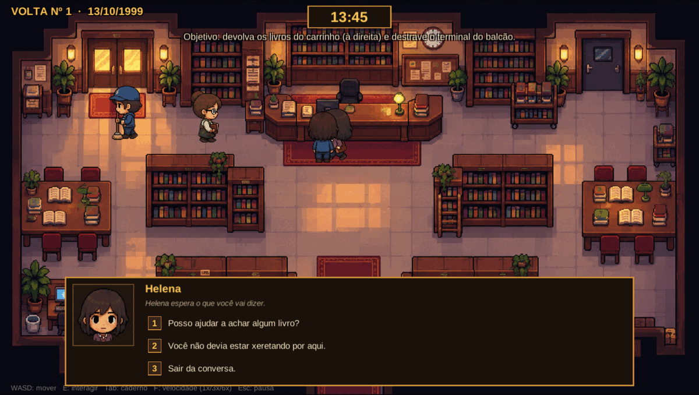

- Escolha com as teclas **1 a 9** ou **clique** na opção.
- O texto abaixo do nome (**“Helena espera o que você vai dizer”**) é o **humor** da pessoa. Ele muda conforme a confiança e a desconfiança dela.
- **“Sair da conversa”** encerra o diálogo sem gastar tempo extra.
- Novas falas aparecem conforme você cumpre requisitos: horário, confiança, pistas e ordem das perguntas.

### 4.4 Caderno de pistas

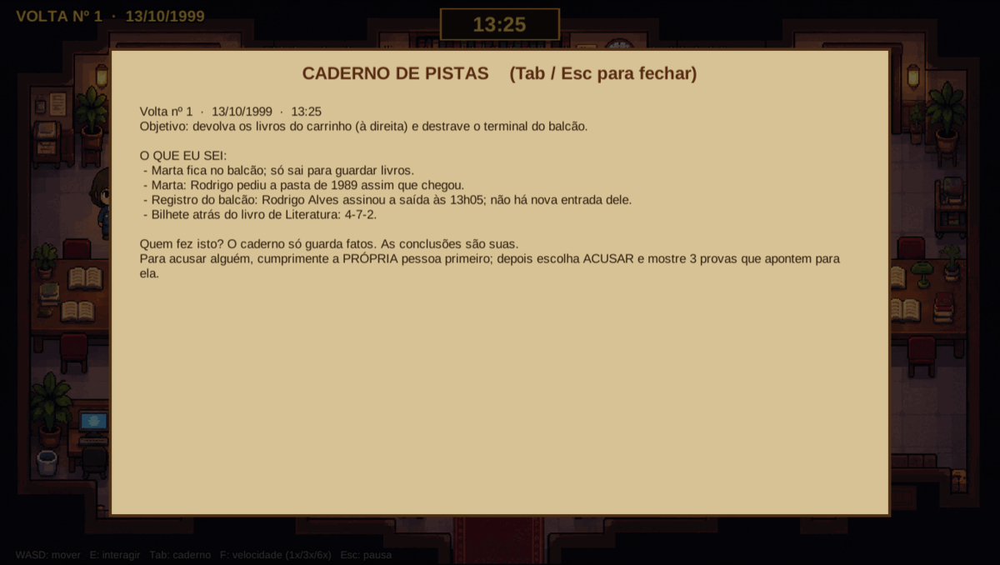

O caderno é o seu registro de fatos. Abra com `Tab` (ou `I`), ou interaja com a **mesa de leitura**.

Ele mostra:

- A **volta atual**, a data e a hora.
- O **objetivo** em vigor.
- A lista **“O QUE EU SEI”**, com os fatos descobertos.
- A regra da acusação, no rodapé.

> O caderno **só guarda fatos**. Ele nunca diz quem é o culpado nem conclui nada por você. As conclusões são suas.

**As pistas são permanentes:** tudo o que entra no caderno continua ali nas voltas seguintes, mesmo que as pessoas esqueçam.

### 4.5 Provas

Toda pista pode ser **mostrada** a uma pessoa durante uma acusação. Uma prova é uma frase do caderno levada para a conversa.

- Uma **prova forte** liga a pessoa ao arquivo, à pasta de 1989 ou ao horário do incêndio. Ela abala o suspeito.
- Uma **prova fraca** não liga a pessoa ao crime. Mostrá-la irrita e aumenta a desconfiança.
- Uma prova de algo que **ainda não aconteceu** naquela volta é um **vazamento de futuro**: a pessoa percebe que você sabe demais.

> Você não precisa decorar quais provas são fortes. Preste atenção no que cada uma realmente prova. Se a prova não tem relação com a pessoa acusada, ela vai soar como acusação vazia.

### 4.6 Confiança e desconfiança

Cada personagem tem dois medidores **invisíveis**:

| Medidor | Como sobe | Como desce | O que causa |
|---|---|---|---|
| **Confiança** | Cumprimentar, ajudar, ser educada, acertar uma prova | Grosseria, acusações erradas, vazar o futuro | Libera falas novas e faz a pessoa acreditar em você |
| **Desconfiança** | Falar do que não deveria saber, acusar sem prova, insistir | Acertar uma prova, pedir desculpas | Fecha diálogos, tranca o arquivo, chama a segurança |

O **humor** exibido no menu de fala é a única forma de medir isso:

- *“espera o que você vai dizer”* — neutro.
- *“parece à vontade com você”* / *“te trata como uma amiga”* — confiança.
- *“estreita os olhos”* / *“te observa como se você fosse uma ameaça”* — desconfiança.
- *“está de cara fechada”* — confiança negativa.

**Consequências importantes:**

- Desconfiança **2** em Dona Marta: ela **tranca o arquivo** naquela volta.
- Desconfiança **3** em qualquer pessoa: ela **chama a segurança** e você é **expulsa** 30 minutos depois — exceto o culpado, que nesse caso **antecipa o incêndio**.
- Confiança **-3 ou menos**: a pessoa **se recusa a falar** com você até o fim da volta.
- Quando alguém passa a desconfiar de você, o **boato chega à Dona Marta** e ela fica mais desconfiada também.

### 4.7 Brilhos de ajuda

Com a opção **Luzes de ajuda** ligada (padrão), aparecem brilhos no cenário:

- **Brilho dourado**: uma tarefa concreta a fazer (carrinho, estante, terminal, arquivo).
- **Brilho azul**: alguém tem algo novo a dizer ou há informação nova em um objeto.

Os brilhos **nunca** indicam pistas por si mesmos; eles apenas apontam onde há interação disponível. Podem ser desligados nas Opções.

### 4.8 Minijogos

Quatro atividades curtas quebram o ritmo da investigação:

| Minijogo | Onde | O que você faz | O que ganha |
|---|---|---|---|
| **Devolver os livros** | Carrinho de devolução | Pegar 6 livros dourados desviando dos que caem | Fim da tarefa (e a chance de agradecer à Marta) |
| **Terminal do balcão** | Computador do balcão | Repetir 5 sequências de luzes | Destrava o terminal e o histórico de acessos |
| **Estante de empréstimos** | Estante inferior esquerda | Ordenar 8 livros por seção e ordem alfabética | Um bilhete com o código da gaveta |
| **Gaveta do arquivo** | Arquivo, parede esquerda | Digitar o código de 3 dígitos | Acesso à pasta do relatório de 1989 |

As regras detalhadas de cada um estão no capítulo 8.5.

### 4.9 Tempo e velocidade

- Uma volta dura **180 minutos de jogo** (12h00 → 15h00).
- No ritmo normal (`1x`), isso equivale a **2 minutos e 30 segundos** reais de exploração — as conversas acrescentam alguns minutos de jogo ao relógio.
- `F` alterna entre **1x, 3x e 6x**. Em `6x`, uma volta dura cerca de **25 segundos**.
- O relógio **pausa** enquanto um diálogo, menu ou minijogo está aberto.
- Acelerar o relógio **não** acelera o personagem nem os textos.

### 4.10 Cenas especiais

Três ilustrações em tela cheia marcam os momentos decisivos:

- **Expulsão** — quando a segurança é chamada.
- **Incêndio** — às 15h, antes de acordar de novo.
- **Final bom** — o epílogo, com a arte completa e a música de vitória.

### 4.11 Música e som

- **Menu:** tema blues tranquilo.
- **Durante o dia:** jazz discreto.
- **15h00:** alarme de incêndio.
- **Final:** tema de vitória.

Os volumes de **música** e **efeitos** são ajustáveis separadamente nas Opções (capítulo 6.4).

---

## 5. Interface e mapa

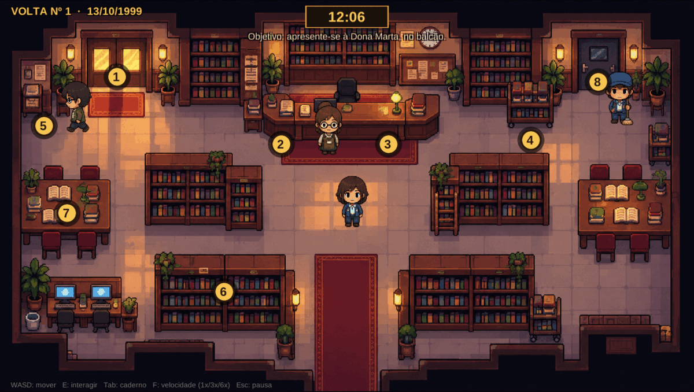

### 5.1 Áreas e pontos de interação

| Nº | Local | O que há | Como interagir |
|---|---|---|---|
| 1 | **Porta de entrada** | Saída para a rua. | `E`: a personagem comenta o dia. Não é possível sair. |
| 2 | **Balcão — livro de registros** | Entradas e saídas do dia, com horários. | `E`: abre o livro. Registros aparecem conforme a hora avança. |
| 3 | **Balcão — terminal** | Computador com verificação por luzes. | `E`: minijogo do terminal; depois, histórico de acessos. |
| 4 | **Carrinho de devolução** | Carrinho cheio de livros, à direita. | `E`: tarefa de devolver os livros (após falar com Marta). |
| 5 | **Gaveta do arquivo** | Móvel de arquivo na parede esquerda. | `E`: teclado numérico de 3 dígitos. |
| 6 | **Estante inferior esquerda** | Estante bagunçada. | `E`: quebra-cabeça de ordenação. |
| 7 | **Mesa de leitura** | Mesas à esquerda. | `E`: abre o caderno de pistas. |
| 8 | **Porta dos fundos** | Porta de serviço, à direita. | `E`: examina a porta. Só abre com a chave da Zeladoria. |

### 5.2 Onde cada personagem está

Os personagens **andam** pelo salão e mudam de lugar com o passar do relógio. Isso faz parte do mistério: observar quem está onde, e quando.

| Personagem | Comportamento no dia |
|---|---|
| Dona Marta | Fica no balcão; sai algumas vezes para guardar livros na estante da esquerda. |
| Seu Jorge | Circula com o esfregão, do canto direito ao balcão e às estantes. |
| Lucas | Chega por volta das 12h20, estuda nas mesas e sai para almoçar; volta às 14h08. |
| Helena | Chega por volta das 12h40, pesquisa nas mesas e estantes; sai por volta das 14h. |
| Rodrigo | Entra às 12h05, vai direto ao arquivo, sai às 13h05 e **diz que não volta**; reaparece às 14h11 pela porta dos fundos. |

> Se uma pessoa não estiver no salão, ela pode estar em outra parte do prédio ou ter saído. O horário importa: muitas falas só existem em uma janela de tempo.

### 5.3 Limites de movimentação

Você anda livremente pelo piso central. **Mesas, estantes, balcão, carrinhos e paredes bloqueiam o caminho** — é preciso contorná-los. Não há andares, escadas ou salas separadas: toda a ação acontece no salão principal.

### 5.4 Controles

| Ação | Teclado | Mouse |
|---|---|---|
| Andar | `W A S D` ou setas | — |
| Interagir | `E` ou `Espaço` | — |
| Avançar diálogo | `E`, `Espaço` ou `Enter` | Clique na caixa |
| Escolher fala | `1` a `9` | Clique na opção |
| Abrir/fechar caderno | `Tab` ou `I` | — |
| Velocidade do tempo | `F` (1x → 3x → 6x → 1x) | — |
| Pausa | `Esc` | — |
| Confirmar em menus | `Enter` | Clique |
| Voltar/fechar | `Esc` | Clique em “Voltar” |

### 5.5 Como saber onde ir

1. Leia o **objetivo** no alto da tela.
2. Siga os **brilhos dourados** para tarefas e os **azuis** para novidades.
3. Abra o **caderno** (`Tab`) para reler os fatos.
4. Observe o **relógio**: algumas pessoas só aparecem em determinados horários.

---

## 6. Preparação da partida

### 6.1 Requisitos

| Item | Mínimo |
|---|---|
| Sistema | Windows 10/11 64 bits ou Linux 64 bits |
| Espaço em disco | Cerca de 150 MB |
| Memória | 2 GB |
| Tela | 1280×720 ou maior (o jogo abre em tela cheia) |
| Entrada | Teclado e mouse |
| Som | Caixas de som ou fones (o jogo depende de áudio para o alarme) |

### 6.2 Abrir o jogo

No Windows:

1. Abra a pasta `SilencioNabibliotecaWin`.
2. Execute **`SilencioNaBiblioteca.exe`**.
3. Se o Windows SmartScreen avisar sobre um aplicativo desconhecido, escolha **“Mais informações” → “Executar assim mesmo”**. O aviso aparece porque o executável não tem assinatura digital.

No Linux, execute `SilencioNaBiblioteca.x86_64` na pasta do build.

> Não é preciso instalar nada. Mantenha todos os arquivos e pastas juntos: o `.exe` depende de `SilencioNaBiblioteca_Data`, `UnityPlayer.dll` e das demais pastas do build.

### 6.3 Menu principal


| Opção | O que faz |
|---|---|
| **Novo Jogo** | Começa uma partida na volta nº 1. |
| **Carregar Jogo** | Ainda não há salvamento; exibe o aviso “Nenhum jogo salvo”. |
| **Configurações** | Abre as Opções (volume, texto, tela). |
| **Créditos** | Mostra a equipe e a frase do jogo. |
| **Sair** | Fecha o jogo. |

Navegação: **setas/WASD** para escolher, **Enter**, **E** ou **Espaço** para confirmar, **mouse** para clicar. `Esc` volta.

### 6.4 Configurações recomendadas

Abra **Configurações** no menu (ou `Esc` → Opções durante o jogo):

| Opção | Padrão | Recomendação |
|---|---|---|
| **Volume geral** | 80% | Ajuste antes de começar; o alarme das 15h é alto. |
| **Música** | 80% | Pode baixar para 50% se quiser ouvir melhor os efeitos. |
| **Efeitos e alarme** | 80% | Mantenha audível: o alarme avisa o fim da volta. |
| **Velocidade do texto** | 1x | Aumente se quiser ler mais rápido. |
| **Tremor de tela** | Ligado | Desligue se sentir desconforto. |
| **Luzes de ajuda** | Ligado | Desligue para um desafio maior. |
| **Tela cheia** | Ligado | Desligue para jogar em janela. |

**Restaurar padrão** volta todos os valores ao original.

> As configurações são salvas automaticamente no computador e continuam valendo na próxima vez que você abrir o jogo.

### 6.5 Iniciar a partida

1. Selecione **Novo Jogo**.
2. Leia a tela de abertura e pressione `E` ou clique para começar.
3. Você acorda às 12h00, diante do balcão. Siga o objetivo no alto da tela.

Não há escolha de dificuldade, personagem ou cenário. A partida começa sempre igual.

### 6.6 Checklist antes de jogar

- [ ] O jogo abriu em tela cheia e o menu aparece completo.
- [ ] A música do menu está tocando.
- [ ] O mouse responde aos cliques no menu.
- [ ] Você sabe abrir o caderno (`Tab`) e pausar (`Esc`).
- [ ] Você entendeu que cada conversa custa minutos de jogo e que o relógio pausa nos menus.

---

## 7. Regras gerais

### 7.1 O tempo não para sozinho

O relógio corre de 12h00 a 15h00 enquanto você **anda e explora**. Ao abrir um diálogo, o caderno ou um minijogo, o relógio **pausa**; mas cada fala escolhida tem um **custo em minutos de jogo**, descontado do relógio quando você volta a andar. A pausa (`Esc`) também congela o jogo.

### 7.2 Conversar custa tempo

Cada pergunta ou fala escolhida consome de **1 a 3 minutos** de jogo. Falas longas, como avisos sobre o incêndio, custam 3 minutos. O tempo consumido é descontado do relógio assim que você volta a andar.

> Planeje: não dá para perguntar tudo a todos na mesma volta. Escolha as conversas mais importantes.

### 7.3 A ordem das perguntas importa

As conversas são encadeadas. Uma pergunta abre a seguinte:

- Só é possível perguntar sobre o arquivo **depois** de perguntar quem passou pelo balcão.
- Só é possível perguntar sobre a autorização **depois** de perguntar sobre a pasta de 1989.
- Cada assunto pode ser perguntado **uma vez por volta**.

Se uma opção não aparece, provavelmente falta um passo anterior, confiança ou horário.

### 7.4 As pessoas esquecem; você não

No fim de cada volta, todos esquecem o que aconteceu — inclusive as conversas. Apenas você mantém:

- As **pistas do caderno**.
- O **código da gaveta** descoberto.
- O **terminal destravado**.
- O conhecimento do que vai acontecer às 15h.

Confiança, desconfiança e as tarefas do dia **recomeçam do zero** em cada volta. Duas coisas ficam: o **terminal destravado** e o **código da gaveta**, uma vez descobertos.

### 7.5 Educação abre portas

Cumprimentar antes de perguntar é a regra de ouro. Cada personagem tem uma abertura educada e uma grosseira. A grosseira rende desconfiança e fecha caminhos; a educada rende confiança e libera perguntas.

Pedir desculpas depois de uma grosseria recupera parte da confiança, mas **não apaga** a desconfiança já gerada.

### 7.6 Falar do futuro é perigoso

Você sabe o que vai acontecer. Dizer isso diretamente a alguém pode:

- Gerar desconfiança, se a pessoa não confia em você.
- Fazer a pessoa achar que você está doente ou ameaçando.
- No caso da pessoa errada, **antecipar o incêndio**.

> Só conte o que vai acontecer a quem já confia em você. E nunca mostre uma prova de um fato que ainda não ocorreu naquela volta.

### 7.7 O fim da volta

A volta termina de três maneiras:

1. **15h00** — o alarme dispara e o incêndio começa.
2. **Expulsão** — se alguém chamar a segurança.
3. **Antecipação** — se o culpado perceber que você sabe, o fogo vem mais cedo.

Em todos os casos, você acorda às 12h00 da mesma data, na volta seguinte.

### 7.8 Regras de ouro

> 1. **Cumprimente antes de perguntar.**
> 2. **Não fale do futuro com quem não confia em você.**
> 3. **Leia o caderno antes de acusar.**
> 4. **Acuse somente com provas que liguem a pessoa ao crime.**
> 5. **Cada volta é uma chance de aprender; nada do caderno se perde.**

---

## 8. Mecânicas e controles

### 8.1 Movimentação

Use `W A S D` ou as setas. A personagem anda em oito direções. Ao se aproximar de um objeto ou pessoa interativo, aparece um **rótulo** perto do chão (por exemplo, “Carrinho de devolução”) e a dica `E: interagir`.

### 8.2 Interação

Pressione `E` ou `Espaço` quando o rótulo aparecer. A interação abre diálogos, o caderno, o livro de registros ou um minijogo. Se você estiver longe, nada acontece.

### 8.3 Conversas

Ao interagir com uma pessoa, abre-se o **menu de fala**:

- O **título** mostra o nome e o humor.
- As **opções** disponíveis aparecem numeradas.
- Falas já usadas naquela volta desaparecem.
- Falas de acusação só aparecem após o cumprimento e após você ter visto o incêndio ao menos uma vez.

**Tipos de fala:**

| Tipo | O que faz |
|---|---|
| **Educada** | Sobe a confiança, libera perguntas. |
| **Grosseira** | Desce a confiança; pode ser reparada com desculpas. |
| **Pergunta** | Obtém um fato para o caderno. |
| **Prova (PROVE)** | Conta algo do futuro para alguém que confia em você; rende confiança e pistas. |
| **Aviso (TELL)** | Avisa sobre o incêndio; funciona com quem confia, irrita quem não confia. |
| **ACUSAR** | Abre o menu de provas (capítulo 8.6). |

### 8.4 Caderno de pistas

`Tab` abre o caderno em qualquer momento do jogo. Ele é a sua memória permanente. Use-o para:

- Conferir o objetivo atual.
- Reler horários e nomes.
- Decidir qual prova mostrar em uma acusação.

O caderno **não** esconde nada: ele lista todos os fatos que você já descobriu, inclusive os que já usou em uma acusação. Quem controla o que ainda pode ser mostrado é o **menu de acusação**, que esconde as provas já apresentadas naquela volta. Na volta seguinte, todas voltam a aparecer.

### 8.5 Tarefas e minijogos

#### a) Devolver os livros (carrinho)

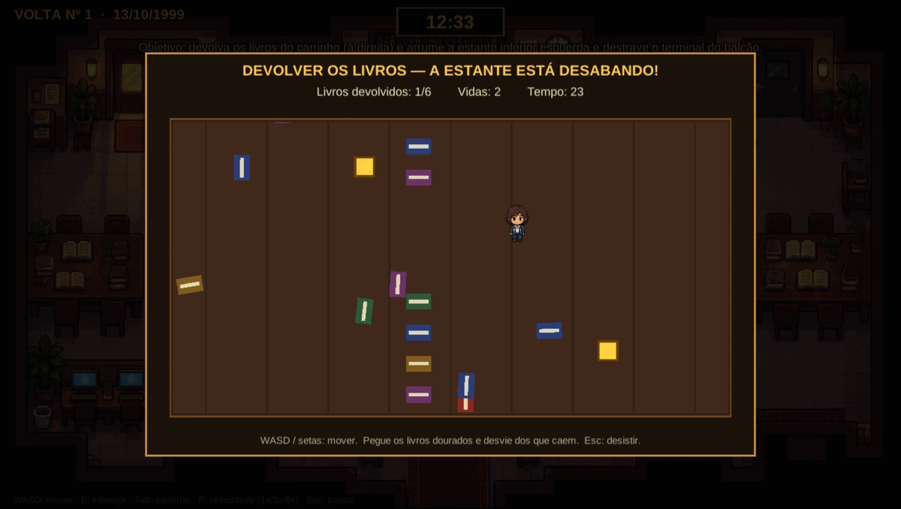

- **Onde:** carrinho de devolução, à direita do salão.
- **Pré-requisito:** falar com Dona Marta e receber a tarefa.
- **Objetivo:** pegar **6 livros dourados**.
- **Perigo:** livros caem do teto e das laterais; cada toque custa **1 vida**.
- **Vidas:** 3. Após um toque, você fica invulnerável por cerca de 1 segundo.
- **Tempo:** 34 segundos.
- **Controles:** `WASD`/setas; `Esc` desiste.
- **Recompensa:** tarefa concluída e 6 minutos de jogo consumidos. Depois, agradeça à Dona Marta para ganhar confiança.
- **Limitação:** se você for atingida 3 vezes ou o tempo acabar, os livros se espalham e a tarefa fica para depois.

> Os livros dourados somem após alguns segundos. Vá direto ao mais próximo.

#### b) Terminal do balcão

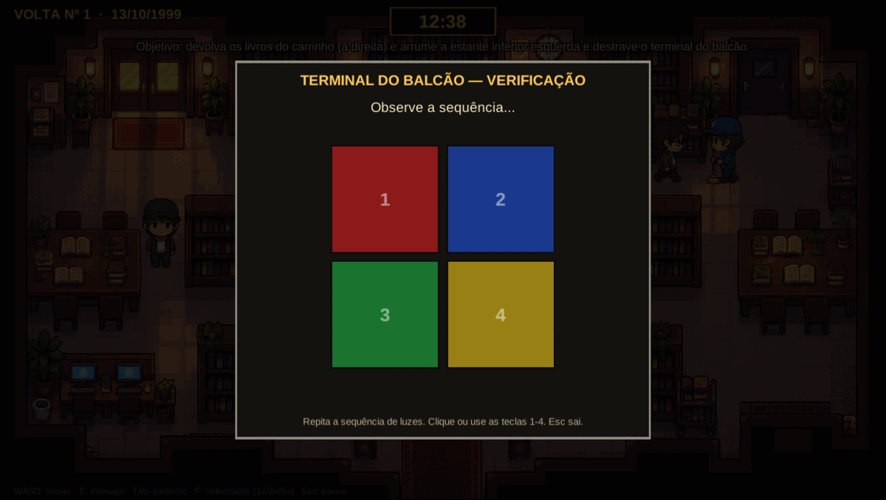

- **Onde:** terminal sobre o balcão.
- **Objetivo:** repetir **5 sequências** de luzes, uma por rodada.
- **Controles:** clique nos quatro botões ou use as teclas `1` a `4`.
- **Erro:** a rodada reinicia; `Esc` cancela.
- **Recompensa:** terminal destravado **permanentemente**. Depois disso, interagir com ele mostra o histórico de acessos, que se atualiza com o horário.

#### c) Estante de empréstimos

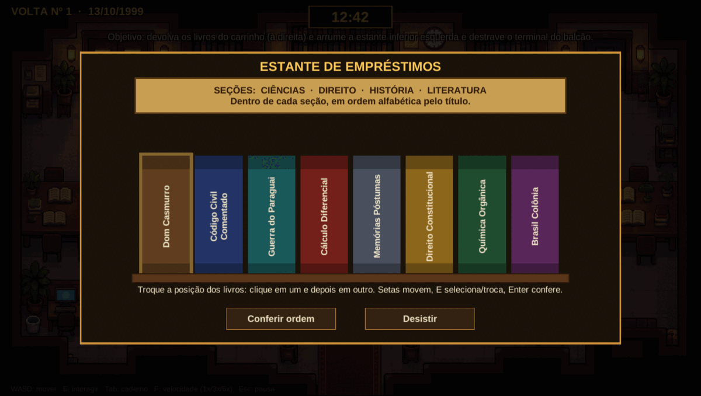

- **Onde:** estante inferior esquerda.
- **Objetivo:** colocar os 8 livros na ordem correta.
- **Regra:** primeiro por **seção** (Ciências, Direito, História, Literatura) e, dentro de cada seção, em **ordem alfabética pelo título**.
- **Controles:** setas movem o cursor; `E`/`Espaço` seleciona e troca; `Enter` confere; ou clique em dois livros para trocá-los.
- **Erro:** a mensagem avisa que a ordem não está certa; você pode tentar de novo.
- **Recompensa:** um bilhete cai de trás do último livro com **três números**.

#### d) Gaveta do arquivo

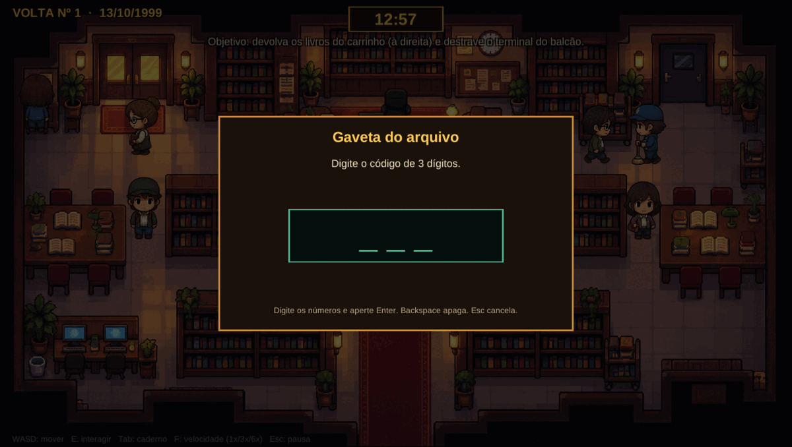

- **Onde:** gaveta do arquivo, parede esquerda.
- **Pré-requisito:** ter descoberto o código de 3 dígitos.
- **Objetivo:** digitar o código.
- **Controles:** números do teclado; `Backspace` apaga; `Enter` confirma; `Esc` cancela.
- **Recompensa:** abre a gaveta e revela o conteúdo da pasta de 1989.
- **Limitação:** se a Dona Marta desconfiar de você (desconfiança 2), a gaveta fica trancada até o fim da volta.

### 8.6 Acusação

Acusar é o momento decisivo. Siga esta ordem:

1. **Tenha provas no caderno.** Sem pelo menos uma prova, a opção de acusar não aparece.
2. **Cumprimente a pessoa** naquela volta. A acusação só aparece depois do cumprimento.
3. Escolha **ACUSAR [nome]**.
4. Selecione uma prova da lista. Cada prova mostrada custa **2 minutos**.
5. Observe a reação:
   - **Prova forte** contra a pessoa certa: ela se abala. Três provas fortes a fazem confessar.
   - **Prova fraca ou sem relação:** ela se irrita, a desconfiança sobe e a confiança cai.
   - **Prova de um fato futuro:** ela percebe que você sabe demais; a desconfiança sobe muito.

Quando a pessoa certa recebe a **terceira prova forte**, o confronto termina em confissão e o final bom começa.

> A acusação não “gasta” a prova para sempre: na volta seguinte, todas as provas do caderno podem ser mostradas de novo.

### 8.7 Alerta do culpado

Se a desconfiança do culpado chegar a **3**, ele percebe que está sendo investigado, corre para o arquivo e **o incêndio começa mais cedo** — cerca de 30 minutos depois. Você ainda pode vencer naquela volta, mas o tempo fica curto.

### 8.8 Expulsão

Se a desconfiança de qualquer outra pessoa chegar a **3**, ela chama a segurança. Cerca de **30 minutos depois**, Dona Marta e Seu Jorge escoltam você para fora. A cena de expulsão aparece, você vê a fumaça subir do outro lado da rua e acorda às 12h00.

### 8.9 Fim da volta

Ao chegar às 15h00 (ou ao ser expulsa), a tela escurece, a cena correspondente aparece e a volta seguinte começa. **Nada do caderno é perdido.** O jogo não mostra “game over”: a repetição é a punição e, ao mesmo tempo, a sua ferramenta.

### 8.10 Pausa e opções

`Esc` abre a pausa:

- **Continuar** — volta ao jogo.
- **Opções** — volumes, texto, tremor, luzes, tela cheia.
- **Voltar ao título** — encerra a partida atual (o progresso não é salvo).

---

## 9. Ações e movimentações

| Ação | Como fazer | Efeito | Limitações |
|---|---|---|---|
| Andar | `WASD` / setas | Move a personagem pelo salão | Móveis e paredes bloqueiam |
| Interagir | `E` / `Espaço` | Abre diálogo, objeto ou minijogo | Precisa estar perto e com o rótulo visível |
| Avançar fala | `E` / `Espaço` / clique | Passa para a próxima linha | — |
| Escolher fala | `1`–`9` / clique | Executa a opção | Consome 1 a 3 minutos de jogo |
| Perguntar | Opção de fala | Adiciona um fato ao caderno | Uma vez por volta; exige ordem e confiança |
| Ajudar | Tarefas e minijogos | Sobe a confiança, rende pistas | Alguns exigem pré-requisito |
| Ler o caderno | `Tab` / `I` / mesa | Mostra objetivo e pistas | Não pausa o tempo |
| Acelerar o tempo | `F` | 1x → 3x → 6x → 1x | Não acelera o personagem |
| Acusar | Opção ACUSAR | Abre o menu de provas | Exige cumprimento, ter visto o incêndio e ter prova |
| Mostrar prova | Opção no menu de acusação | Abala ou irrita o acusado | Custa 2 minutos por prova |
| Pausar | `Esc` | Abre a pausa | — |

### Fluxo de uma volta

```
12:00  Acorda no balcão
  │
  ├── Conversar / ajudar / investigar  ──►  pistas no caderno
  │        │
  │        ├── confiança sobe  ──►  falas novas
  │        └── desconfiança 3  ──►  expulsão (fim da volta)
  │
  ├── Culpado alertado  ──►  incêndio antecipado
  │
  └── 15:00  ──►  incêndio  ──►  nova volta (pistas mantidas)
                                   │
                                   └──►  acusação com 3 provas fortes  ──►  FINAL BOM
```

---

## 10. Modos de jogo

O jogo tem um único modo de partida. O que muda entre jogadores é o **estilo** de investigação.

### 10.1 Novo Jogo

Partida completa, sempre a partir da volta nº 1. Não há seleção de dificuldade nem de personagem.

### 10.2 Carregar Jogo

Existe no menu, mas **não há salvamento**: a opção apenas informa que nenhum jogo foi salvo. Para continuar, é preciso jogar a partida inteira em uma sessão.

### 10.3 Pausa

A pausa interrompe o relógio e permite ajustar opções. **Voltar ao título** encerra a partida.

### 10.4 Créditos

Mostra os integrantes da equipe, o curso e a frase-tema do jogo:

> “Você tem o poder de mudar a situação apenas com a observação.”

### 10.5 Como jogar

A tela **“Como Jogar”** resume os controles e as regras essenciais. No menu principal, abra com a tecla `H`.

### 10.6 Estilos de investigação

| Estilo | Como joga | Vantagens | Riscos |
|---|---|---|---|
| **Cautelosa** | Cumprimenta, ajuda, pergunta aos poucos | Confiança alta, mais falas, menos expulsões | Gasta mais tempo por volta |
| **Direta** | Vai ao ponto, mostra provas cedo | Avança rápido | Desconfiança alta, incêndio antecipado |
| **Metódica** | Faz todas as tarefas e lê o caderno | Reúne provas sólidas antes de acusar | Pode deixar o culpado escapar no horário |

Não há “modo fácil” ou “difícil”: a velocidade `F` funciona como ajuste de ritmo. Use `1x` para explorar e `3x`/`6x` para esperar horários específicos.

---

## 11. Condições de vitória, derrota e conclusão

### 11.1 Vitória — final bom

A vitória acontece quando você:

1. Está em uma volta com o caderno contendo **pelo menos uma prova**.
2. **Cumprimenta a pessoa culpada**.
3. Escolhe **ACUSAR** e mostra **três provas fortes** que a apontem.

A pessoa confessa, o relógio avança, a música de vitória toca e o epílogo aparece em tela cheia:

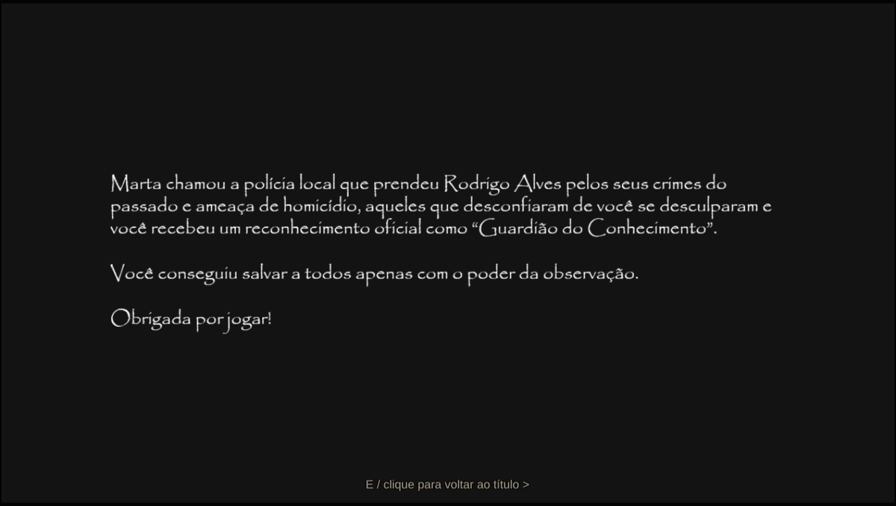

Pressione `E` ou clique para voltar ao título.

### 11.2 Derrota temporária — incêndio

Se você não acusar antes das 15h00, o alarme dispara, a biblioteca queima e você volta às 12h00. **Isso não é o fim do jogo**: é a progressão normal. Você mantém as pistas.

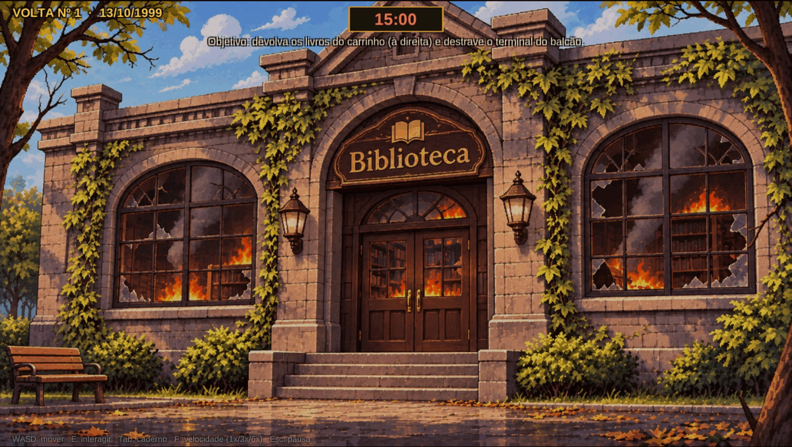

### 11.3 Derrota temporária — expulsão

Se a desconfiança de alguém chegar a 3, você é escoltada para fora antes das 15h.

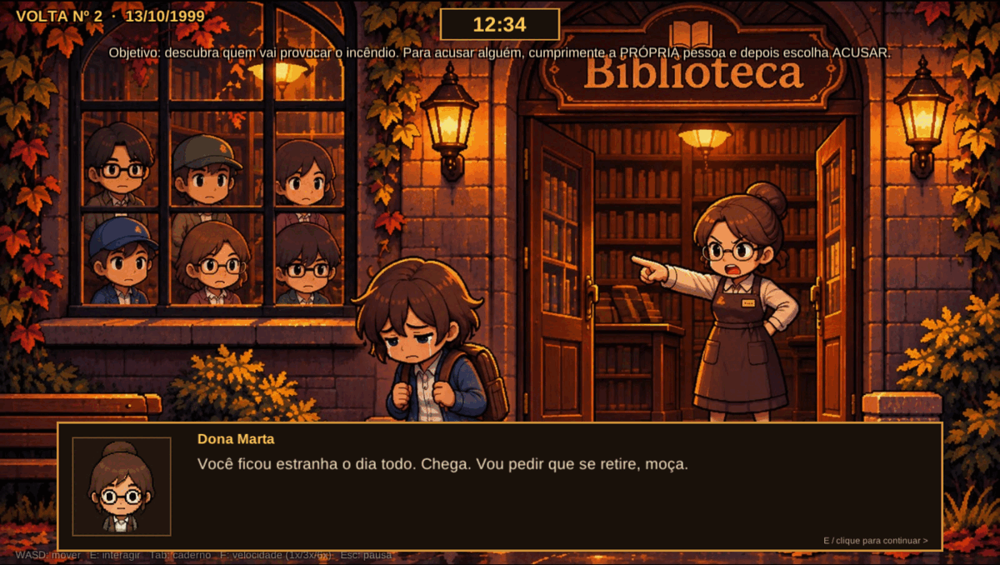

Você ainda vê a fumaça e volta às 12h00. As pistas continuam no caderno.

### 11.4 Incêndio antecipado

Se o culpado desconfiar de você (desconfiança 3), ele corre para o arquivo e o incêndio começa antes das 15h. Você pode tentar acusá-lo nesse intervalo, mas o tempo é curto.

### 11.5 Acusações erradas

Acusar a pessoa errada não termina a partida, mas tem custo:

- Cada prova sem relação **aumenta a desconfiança** e **diminui a confiança**.
- Se a desconfiança chegar a 3, você é expulsa.
- Se a pessoa for Dona Marta, a desconfiança 2 **tranca o arquivo** naquela volta.

### 11.6 Tabela de consequências

| Situação | Consequência imediata | Consequência na volta seguinte |
|---|---|---|
| Incêndio às 15h | Fim da volta | Pistas mantidas; volta incrementada |
| Expulsão | Fim da volta | Pistas mantidas; pessoas desconfiadas esquecem |
| Incêndio antecipado | Menos tempo na volta | Pistas mantidas |
| Prova forte no culpado | Pressão +1 | — |
| 3 provas fortes | Confissão e final bom | Partida encerrada |
| Prova fraca | Desconfiança +1, confiança -1 | — |
| Prova de fato futuro | Desconfiança +2, confiança -1 | — |
| Desconfiança 2 na Marta | Arquivo trancado | — |
| Desconfiança 3 em alguém | Segurança chamada; expulsão em 30 min | — |
| Desconfiança 3 no culpado | Ele corre para o arquivo; incêndio antecipado | — |
| Confiança -3 | Pessoa se recusa a falar | — |
| Falar do futuro para quem não confia | Desconfiança +1 a +2 | — |

### 11.7 Finais

O jogo tem **um final bom** e **finais de repetição** (incêndio ou expulsão). Não há final “ruim” permanente: por mais voltas que você dê, o caderno guarda o progresso e a vitória continua possível.

---

## 12. Exemplos de partidas

Os exemplos abaixo usam horários aproximados e **não revelam o culpado**. A solução completa está no Apêndice A.

### 12.1 Primeira volta — reconhecimento

| Hora | Ação | Resultado |
|---|---|---|
| 12:00 | Cumprimente Dona Marta e pergunte como tem sido o dia | Confiança +1; primeira pista |
| 12:05 | Observe Rodrigo entrando e indo ao arquivo | Contexto |
| 12:20 | Pergunte a Marta quem já passou | Nome de Rodrigo e da pasta de 1989 |
| 12:25 | Aceite a tarefa do carrinho e conclua o minijogo | Confiança da Marta |
| 12:30 | Arrume a estante inferior esquerda | Bilhete com três números |
| 12:40 | Destrave o terminal do balcão | Histórico de acessos disponível |
| 13:06 | Leia o livro de registros | Horário de saída de Rodrigo |
| 14:11 | Observe a porta dos fundos e o terminal | Registro de acesso com chave |
| 15:00 | Incêndio | Fim da volta; todas as pistas mantidas |

### 12.2 Volta seguinte — confirmar e cruzar

1. Cumprimente as pessoas e recupere a confiança (as tarefas podem ser refeitas).
2. Confirme os horários no livro de registros e no terminal.
3. Converse com Lucas e Helena sobre o que viram.
4. Volte ao arquivo com o código e veja o que restou da pasta.
5. No caderno, separe os fatos que ligam alguém ao arquivo e ao horário do incêndio.

### 12.3 Volta final — a acusação

1. Verifique no caderno se há **três provas fortes** contra a mesma pessoa.
2. Vá até essa pessoa e **cumprimente-a**.
3. Escolha **ACUSAR**.
4. Mostre as três provas, uma a uma, observando as reações.
5. Na terceira, a pessoa confessa e o final bom começa.
6. Pressione `E` para voltar ao título.

### 12.4 Exemplo de erro — falar do futuro cedo

Você chega a Marta na primeira volta e diz: *“Às 15h vai começar um incêndio no arquivo.”* Ela ainda não confia em você. A fala soa como ameaça ou brincadeira de mau gosto: a desconfiança sobe, ela anota seu nome e o arquivo pode ser trancado. Na volta seguinte, nada disso é lembrado — mas você perdeu tempo e uma oportunidade.

**Lição:** avisos sobre o futuro só funcionam com quem já confia em você (confiança 2 ou mais).

### 12.5 Exemplo de erro — acusar sem prova

Você desconfia de alguém e escolhe ACUSAR mostrando uma pista que não tem relação com a pessoa. Ela se irrita, a desconfiança sobe e a conversa acaba. Se isso acontecer três vezes com a mesma pessoa, você é expulsa antes de conseguir a confissão.

**Lição:** acusar é o último passo, não o primeiro.

---

## 13. Dúvidas frequentes

**1. O jogo salva sozinho?**
Não. Fechar o jogo reinicia a partida. Uma sessão inteira dura de 15 a 30 minutos.

**2. Eu “perdi” quando o incêndio acontece?**
Não. O incêndio faz parte do jogo: cada volta mantém as pistas do caderno. A derrota só existe se você desistir.

**3. Posso acusar na primeira volta?**
Não. A opção ACUSAR só aparece depois que você presencia o primeiro incêndio e cumprimenta a pessoa.

**4. Quantas voltas existem?**
Não há limite. O jogo continua até você acusar corretamente.

**5. Como acelero o jogo?**
Pressione `F` para alternar 1x, 3x e 6x. O indicador “>> velocidade” aparece sob o relógio.

**6. Não sei onde ir.**
Siga o objetivo no alto da tela, os brilhos dourados (tarefas) e azuis (novidades), e abra o caderno com `Tab`.

**7. O que significa o brilho azul?**
Que alguém tem uma fala nova ou que um objeto tem informação nova para você.

**8. Por que uma pessoa não fala mais comigo?**
A confiança dela chegou a -3 ou a desconfiança passou do limite. Na volta seguinte, ela esquece.

**9. Por que o arquivo está trancado?**
A Dona Marta desconfiou de você (desconfiança 2). Na próxima volta, a gaveta volta a abrir.

**10. Por que o incêndio começou antes das 15h?**
Você alertou o culpado (desconfiança 3). Ele correu para o arquivo.

**11. Por que fui expulsa?**
Alguém chamou a segurança porque a desconfiança chegou a 3. A expulsão acontece 30 minutos depois do aviso.

**12. Como mostro uma prova?**
Cumprimente a pessoa, escolha **ACUSAR** e selecione a prova na lista. Cada prova custa 2 minutos.

**13. Mostrei uma prova e ela “sumiu” do caderno.**
Provas mostradas ficam indisponíveis só naquela volta. Na volta seguinte, voltam.

**14. Posso conversar durante o incêndio?**
Não. O incêndio encerra a volta.

**15. O jogo tem violência ou conteúdo impróprio?**
Não. Há menção a um incêndio criminoso e a um relatório antigo, sem cenas gráficas.

**16. Como saio do jogo?**
`Esc` → **Voltar ao título**, ou feche a janela. Não há salvamento.

---

## Apêndice A — Solução completa (com spoilers)

> **Atenção:** este apêndice revela o culpado e o caminho mais curto para o final. Leia apenas se estiver travado.

### A.1 O culpado

**Rodrigo Alves**, o professor. Ele retirou a pasta do relatório de vistoria de 1989 porque o documento compromete o nome de seu pai, que assinou a aprovação de uma fiação elétrica reprovada. Para apagar o documento, ele roubou a chave da Zeladoria 02 do molho de Seu Jorge, voltou às 14h11 pela porta de serviço e provocou o incêndio no arquivo às 15h.

### A.2 Caminho mais curto (2 voltas)

**Volta 1 — juntar as três provas**

| Passo | Hora | O que fazer | Pista |
|---|---|---|---|
| 1 | 12:00 | Cumprimente Marta no balcão (o cumprimento já entrega a tarefa do carrinho). | Tarefa ativa |
| 2 | 12:01 | “Bom dia, Dona Marta…” | Confiança +1 |
| 3 | 12:02 | “Como tem sido o dia por aqui?” | Marta fica no balcão |
| 4 | 12:20 | “E quem já passou por aqui?” | Rodrigo foi ao arquivo |
| 5 | 12:22 | “O professor costuma frequentar o arquivo?” | **R1989** |
| 6 | 12:24 | Resolva a estante (seção + ordem alfabética) | Código **472** |
| 7 | 12:24 | Corra até a gaveta do arquivo e abra com 472 **antes das 12h28** | **PASTA_ANTES** (opcional; a janela é curta) |
| 8 | 12:28 | Volte à gaveta (ou abra pela primeira vez agora) | **DOC** (pasta vazia, ficha “R. Alves”) |
| 9 | 12:30 | Conclua a tarefa do carrinho e agradeça a Marta | Confiança alta |
| 10 | 12:45 | Com Jorge: cumprimente, “Posso ajudar…”, “trabalha aqui há muito tempo?” e “cuida das chaves?” | **CHAVE02** |
| 11 | 13:00 | Jorge: “O senhor parece aflito.” | **S_jorge** (molho perdido após o almoço) |
| 12 | 13:02 | Jorge: “O senhor viu alguém perto do seu carrinho hoje?” | **CARRINHO** (Rodrigo às 12h50) |
| 13 | 13:06 | Leia o livro de registros | Rodrigo saiu às 13h05 |
| 14 | 14:11 | Destrave o terminal e leia o histórico de acessos | Porta aberta com a chave Zeladoria 02 |
| 15 | 15:00 | Incêndio: fim da volta | Pistas mantidas |

**Volta 2 — acusar**

| Passo | Hora | O que fazer |
|---|---|---|
| 1 | 14:11 | Espere Rodrigo voltar pela porta dos fundos e vá até ele. |
| 2 | 14:12 | Cumprimente-o (“Boa tarde, professor…”). |
| 3 | 14:13 | Escolha **ACUSAR** e mostre **R1989**, **DOC** e **CARRINHO**. |
| 4 | — | Na terceira prova, ele confessa. O final bom começa. |

> Se quiser terminar mais cedo, acuse entre **12h58 e 13h04**, antes de Rodrigo sair. A janela é curta porque ele deixa a biblioteca às 13h05. Depois disso, só às 14h11.

### A.3 Rota alternativa — a confissão por blefe

1. Mostre **duas** provas fortes a Rodrigo (por exemplo, R1989 e DOC).
2. Espere até **14h11**, quando ele volta.
3. Escolha **ACUSAR** → **“Eu sei o que o senhor vai fazer às 15h.”**
4. Com duas provas já mostradas e o horário certo, ele desmorona e confessa.

Se você usar o blefe antes das 14h11 ou com menos de duas provas, ele percebe o blefe, empurra você e antecipa o incêndio.

### A.4 Provas fortes contra Rodrigo

| Prova | Como obter | Válida a partir de |
|---|---|---|
| **R1989** | Marta: “O professor costuma frequentar o arquivo?” | 12:10 |
| **DOC** | Gaveta do arquivo aberta com 472, depois das 12:28 | 12:28 |
| **CARRINHO** | Jorge: “O senhor viu alguém perto do seu carrinho hoje?” | 12:58 |
| **REG** | Livro de registros, depois das 13:06 | 13:06 |
| **ACESSO** | Terminal destravado, depois das 14:11 | 14:11 |
| **S_lucas** | Lucas: “Reparou em alguma coisa quando voltou?” (depois das 14:08) | 14:11 |

### A.5 Caminho completo do dia (referência)

| Hora | O que acontece |
|---|---|
| 12:00 | A biblioteca abre; Marta no balcão. |
| 12:05 | Rodrigo entra e vai ao arquivo. |
| 12:20 | Lucas chega. |
| 12:28 | Rodrigo guarda a pasta e sai do arquivo. |
| 12:40 | Helena chega. |
| 12:50–12:58 | Rodrigo passa pelo carrinho de Seu Jorge; o molho de chaves desaparece. |
| 13:05 | Rodrigo assina a saída e vai embora. |
| 14:00 | Helena sai. |
| 14:11 | Rodrigo volta pela porta dos fundos com a chave Zeladoria 02. |
| 14:08 | Lucas volta do almoço e vê Rodrigo entrar pelos fundos. |
| 14:52 | Rodrigo chega ao arquivo. |
| 15:00 | Alarme e incêndio. |

---

## Apêndice B — Pistas, provas e onde encontrá-las

### B.1 Fatos do caderno

| Pista | Onde/Como | Observação |
|---|---|---|
| **LOOP** | Primeiro incêndio | O dia se repete; só você lembra. |
| **FOGO** | Primeiro incêndio | Fumaça no arquivo e vulto de casaco. |
| **S_marta** | Marta: “Como tem sido o dia?” | Marta fica no balcão. |
| **R1989** | Marta: “O professor costuma frequentar o arquivo?” | Rodrigo pediu a pasta de 1989. |
| **MARTA_ABRIU** | Marta: “A senhora deixou ele entrar sem conferir?” | Exige confiança 2. |
| **CHAVE02** | Jorge: “O senhor cuida das chaves?” | Zeladoria 02 abre a porta de serviço. |
| **S_jorge** | Jorge: “O senhor parece aflito.” (após 13h) | Perdeu o molho depois do almoço. |
| **CARRINHO** | Jorge: “Viu alguém perto do carrinho?” | Rodrigo às 12h50. |
| **JORGE_FOGO** | Jorge: “O senhor parece cansado.” | Piada sobre pôr fogo. |
| **S_lucas** | Lucas: “Reparou em alguma coisa?” (após 14h08) | Viu Rodrigo entrar pelos fundos. |
| **LUCAS_FUMA** | Lucas: “Você está com cheiro de cigarro.” | Lucas tem isqueiro. |
| **TESTEMUNHA** | Lucas: “Você vai sair às 13h40…” | Lucas confirma o que viu. |
| **S_helena** | Helena: “Vai ficar muito tempo?” | Ela sai às 14h. |
| **H1989** | Helena: “O que você pesquisa?” | Relatório de 1989 sumiu. |
| **HELENA_PEDIU** | Helena: “Você parece saber mais sobre 1989.” | Helena também pediu a pasta. |
| **S_rodrigo** | Rodrigo: “O senhor vai ficar muito tempo?” | Ele diz que sai às 13h05. |
| **REG** | Livro de registros, após 13h06 | Saída de Rodrigo às 13h05. |
| **CODE** | Estante ordenada | Bilhete: 4-7-2. |
| **PASTA_ANTES** | Arquivo antes das 12h28 | A pasta ainda estava lá. |
| **DOC** | Arquivo depois das 12h28 | Pasta vazia; ficha “R. Alves”. |
| **ACESSO** | Terminal, após 14h11 | Porta aberta com Zeladoria 02. |
| **SUSP_…** | Quando alguém desconfia de você | Registro de que a pessoa percebeu. |

### B.2 Provas e efeito

| Prova | Forte? | Aponta para |
|---|---|---|
| R1989 | Sim | Rodrigo |
| DOC | Sim | Rodrigo |
| CARRINHO | Sim | Rodrigo |
| REG | Sim | Rodrigo |
| ACESSO | Sim | Rodrigo |
| S_lucas | Sim | Rodrigo |
| PASTA_ANTES | Não | Contexto |
| H1989 | Não | Contexto |
| HELENA_PEDIU | Não | Helena (motivo, não crime) |
| MARTA_ABRIU | Não | Marta (negligência, não crime) |
| S_jorge | Não | Jorge (chave perdida) |
| CHAVE02 | Não | Jorge (chave) |
| JORGE_FOGO | Não | Jorge (piada) |
| LUCAS_FUMA | Não | Lucas (isqueiro) |

> Provas “não” não são inúteis para a investigação — elas ajudam a descartar suspeitos e a liberar falas. Só não bastam para a confissão.

---

## Apêndice C — Checklist de validação do manual

Conferência feita antes da publicação, segundo o guia de elaboração:

- [x] O objetivo está claro (capítulos 1 e 3).
- [x] Todos os componentes foram explicados (capítulo 4).
- [x] A preparação da partida está completa (capítulo 6).
- [x] As regras estão em ordem lógica (capítulos 7 a 9).
- [x] Todas as ações estão descritas (capítulo 9).
- [x] Não existem termos sem explicação (glossário no Apêndice D).
- [x] As condições de vitória e derrota estão definidas (capítulo 11).
- [x] As informações não apresentam contradições (revisão final).
- [x] O manual foi escrito para quem nunca jogou (linguagem direta, “você”).
- [x] Há imagens, tabelas, fluxograma e exemplos práticos.

---

## Apêndice D — Glossário e ficha técnica

### D.1 Glossário

| Termo | Significado |
|---|---|
| **Volta** | Uma repetição do dia 13/10/1999, de 12h00 a 15h00. |
| **HUD** | Elementos fixos da tela: relógio, objetivo, diálogo, controles. |
| **Pista** | Fato anotado no caderno. |
| **Prova** | Pista que pode ser mostrada durante uma acusação. |
| **Prova forte** | Prova que liga a pessoa acusada ao crime. |
| **PROVE** | Fala que conta algo do futuro a alguém que confia em você. |
| **TELL** | Aviso sobre o incêndio; só funciona com confiança. |
| **Desconfiança** | Medidor oculto que leva à expulsão ou ao arquivo trancado. |
| **Pressão** | Número de provas fortes já mostradas ao culpado. |
| **Loop** | O mesmo que volta. |
| **Minijogo** | Atividade curta com regras próprias (livros, terminal, estante, gaveta). |
| **Pixel art** | Estilo gráfico de imagem em pixels grandes. |

### D.2 Ficha técnica

| Item | Informação |
|---|---|
| Título | Silêncio na Biblioteca |
| Versão do manual | 1.0 (novembro de 2026) |
| Gênero | Aventura narrativa / investigação |
| Jogadores | 1 |
| Duração | 15 a 30 minutos |
| Engine | Unity 6000.6.6f1 |
| Plataformas | Windows 10/11 64 bits · Linux 64 bits |
| Resolução padrão | 1920×1080, tela cheia |
| Áudio | Música e efeitos com volumes separados |
| Salvamento | Não há |
| Classificação | Livre |
| Equipe | Arthur Carvalho Rotkis, Cauê Iwamoto Meira, Hanna de Oliveira Melo, Sérgio de Siqueira Santos |
| Instituição | FEI — Jogos Digitais, 7º ciclo |

### D.3 Suporte

Se o jogo não abrir:

1. Confirme que a pasta do build está completa (`.exe`, `_Data`, `UnityPlayer.dll`).
2. Atualize os drivers de vídeo.
3. Verifique se o áudio do sistema está ativo.
4. No Windows, libere o executável no antivírus/SmartScreen.
5. Se a janela abrir pequena, use **Configurações → Tela cheia**.

---

*Fim do manual. Bom jogo — e não deixe o relógio chegar às 15h sem respostas.*
