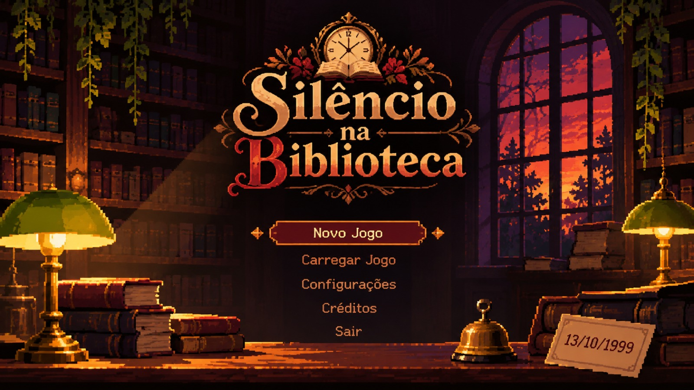
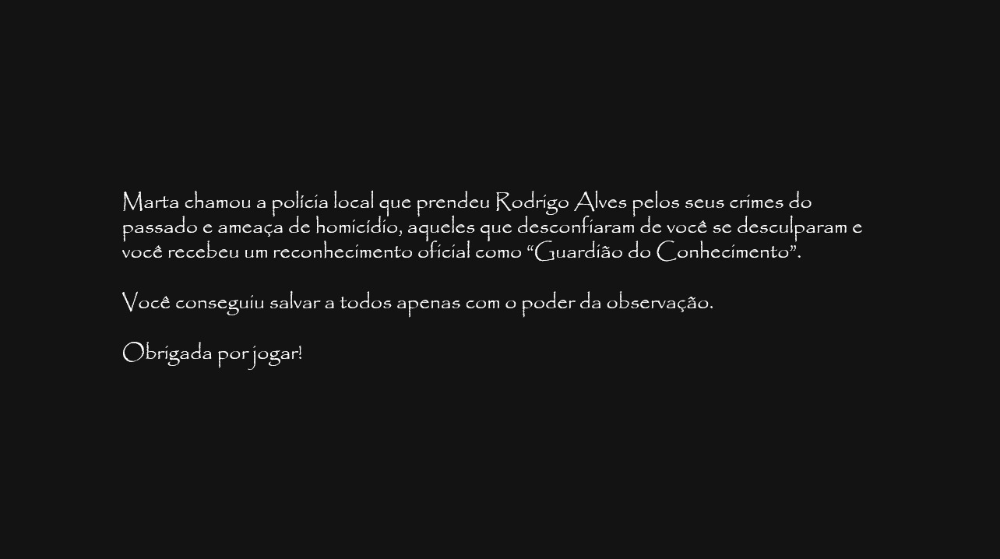
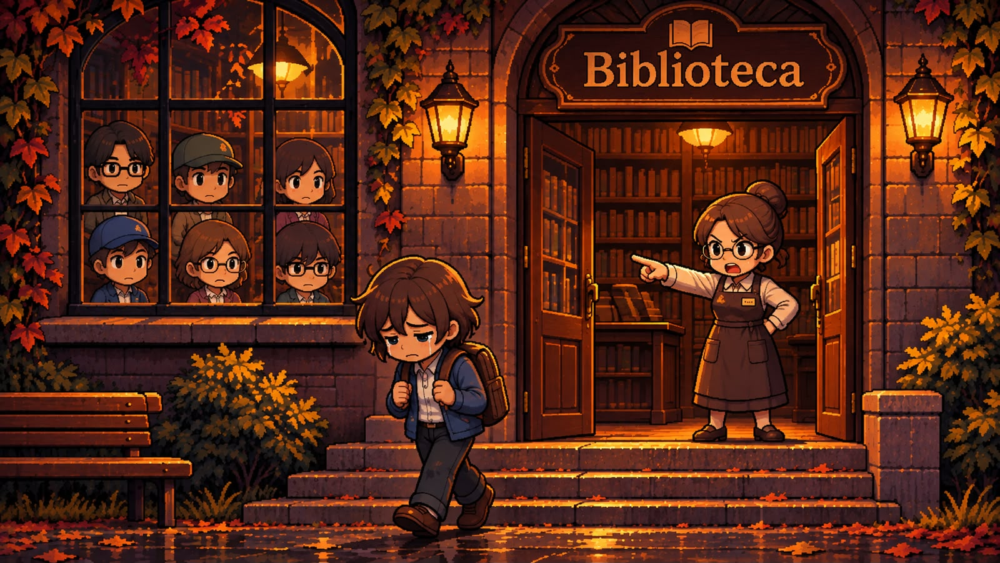
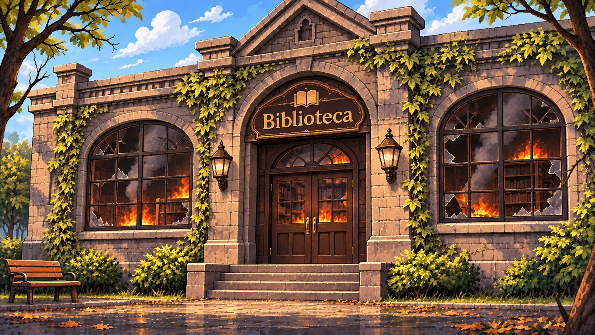

# Silêncio na Biblioteca 👾 — Jogos Digitais · FEI (7º ciclo)

> 🎮 **Demo jogável (Unity)**: pasta [`SilencioNaBiblioteca_loop_v9/SilencioNaBiblioteca/`](SilencioNaBiblioteca_loop_v9/SilencioNaBiblioteca/) — instruções completas em [`SETUP.md`](SilencioNaBiblioteca_loop_v9/SilencioNaBiblioteca/SETUP.md).
>
> Resumo: abra a pasta no Unity Hub (Editor **6000.6.6f1**) e pressione Play — a cena `Assets/Scenes/Main.unity` já está montada.

Arthur Carvalho Rotkis · Cauê Iwamoto Meira · Hanna de Oliveira Melo · Sérgio de Siqueira Santos

> 🌐 **Jogue no navegador**: [silencio-na-biblioteca no itch.io](https://hannaorlmelogmailcom.itch.io/silencio-na-biblioteca) — sem instalar nada.

---

## 🌐 Versão web (itch.io)

Build WebGL pronto para publicar no itch.io. O jogo roda no navegador, com áudio e tela cheia, sem instalar nada.

▶️ Página publicada: <https://hannaorlmelogmailcom.itch.io/silencio-na-biblioteca>

**Publicar:**

1. Crie o projeto no itch.io com *Kind of project* = **HTML**.
2. Envie o arquivo `SilencioNaBibliotecaWeb.zip` (39 MB) e marque **This file will be played in the browser**.
3. Em *Embed options*, use **1280 × 720**, ligue *Fullscreen button* e *Mobile friendly* (opcional).
4. Salve e abra a página: o carregamento mostra o título do jogo e a barra de progresso; o áudio começa no primeiro clique/tecla.

**Rebuild** (a pasta gerada fica fora do git, como os builds de desktop):

```bash
cd SilencioNaBiblioteca_loop_v9/SilencioNaBiblioteca
~/Unity/Hub/Editor/6000.6.6f1/Editor/Unity -batchmode -quit \
  -projectPath "$PWD" -buildTarget WebGL \
  -executeMethod SilencioBiblioteca.EditorTools.BuildWeb.Perform
```

O script `Assets/Editor/BuildWeb.cs` gera `SilencioNaBibliotecaWeb/` na raiz do repositório com o template próprio `Assets/WebGLTemplates/Itch` (tela de carregamento no tema do jogo, botão de tela cheia, favicon). A compressão é **Gzip com decompression fallback**, que funciona tanto no itch.io quanto em qualquer servidor estático simples.

---

## 📘 Manual do jogador

Manual completo do jogo, com apresentação, história, objetivos, componentes, mapa comentado, regras, mecânicas, condições de vitória e partidas comentadas.

- 📖 [Manual completo em Markdown](MANUAL.md)
- 📄 [Manual em PDF (34 páginas, 4 MB)](Manual_Silencio_na_Biblioteca.pdf)

---

## 🎨 Design do menu e das cenas

Artes que dão o acabamento visual do jogo. Cada uma aparece em um momento específico da história.

### Menu principal

Substitui o menu antigo feito só com texto: fundo ilustrado, placa de seleção com os losangos nas pontas e os itens na fonte original da arte. Navegação por setas/WASD, Enter/E e mouse; a opção **Créditos** abre a ficha da equipe.



### Final bom

Tela do epílogo exibida ao resolver o caso: a arte entra em tela cheia com fade e a música de vitória.



### Expulsão da biblioteca

Quando Dona Marta e Seu Jorge te colocam para fora, a cena ilustrada toma a tela e os diálogos acontecem por cima dela.



### A biblioteca em chamas

Última imagem de cada volta que termina em incêndio, antes de acordar de novo às 12h.



---

## 🖼️ Artes de referência

Base da pixel art usada no cenário, nos móveis e nos personagens.


